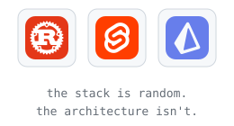

  <picture>
    <source media="(prefers-color-scheme: dark)" srcset="banners/header-dark.svg">
    
  </picture>

  <picture>
    <source media="(prefers-color-scheme: dark)" srcset="https://readme-typing-svg.demolab.com?font=Fira+Code&size=15&duration=2600&pause=2200&center=true&vCenter=true&width=520&height=30&lines=i+design+systems.+the+language+is+a+detail.;currently+planning+my+house+in+code.;ask+me+about+curbs.&color=8B949E">
    
  </picture>

  
  
  

Software engineer at **[b2match](https://www.b2match.com)**, working across the whole product, from the interface down to the database. I care more about how the pieces fit together than about which language they're written in.

Off the clock I build tools for my most demanding client: my own house. Every curb, conduit and junction box gets planned in code before it gets bought.

### Stack

  <picture>
    <source media="(prefers-color-scheme: dark)" srcset="banners/stack-dark.svg">
    
  </picture>

### Projects

<table>
  <tr>
    <td width="50%" valign="top">
      
      <h4><a href="https://github.com/MDBossss/obrub">Obrub</a></h4>
      Curb planner for yards. Import a Photoshop outline, get every piece and cut, print it on A4.  
      
      
      
    </td>
    <td width="50%" valign="top">
      
      <h4><a href="https://github.com/MDBossss/trasa">Trasa</a></h4>
      Wiring planner for a house. Conduits, junction boxes and WAGO connectors to scale, with a parts list.  
      
      
      
    </td>
  </tr>
  <tr>
    <td width="50%" valign="top">
      
      <h4><a href="https://github.com/MDBossss/sentio">Sentio</a></h4>
      Describe your mood, get an AI playlist that plays from YouTube. Four micro-frontends in React, Vue and Solid.  
      
      
      
      
    </td>
    <td width="50%" valign="top">
      
      <h4><a href="https://github.com/MDBossss/examium">Examium</a></h4>
      Collaborative quiz maker. Build quizzes together, take them, and see the results.  
      
      
      
      
    </td>
  </tr>
</table>

  Also: <a href="https://github.com/MDBossss/alisa"><b>Alisa</b></a>, a scraper that finds the cheapest car part across several web shops by part number.

